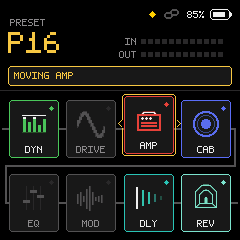
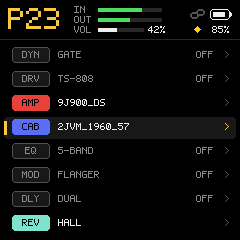
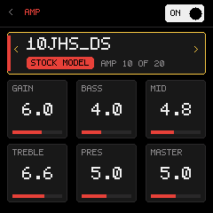
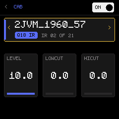
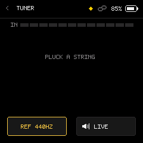
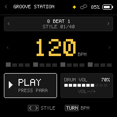
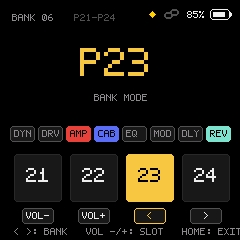

<p align="center">
  
  
  
  
  
</p>

<h1 align="center">Onyx</h1>

<p align="center"><b>An open-source guitar DSP platform, custom firmware, and real-time emulation suite for JieLi AC791N / WL82 hardware.</b><br>
Free software (GPL-3.0-only), built with modular components from the open-source audio ecosystem (see <a href="#credits">Credits</a> and <a href="LICENSING.md">LICENSING.md</a>).</p>

> [!CAUTION]
> **Early access: work in progress, no warranty, use at your own risk.** Onyx runs on real physical hardware, in the native desktop emulator, and in the WebAssembly simulator. Firmware flashing writes directly to the physical SPI-NOR flash memory of your device: **always back up first** (using the Onyx Web Editor or the recovery tools below), and read [Getting back & Recovery](#getting-back--recovery) before you start.
>
> **NOT AFFILIATED WITH M-VAVE OR DONNER.** Onyx is an independent, unofficial interoperability project. It contains no vendor application firmware, amp models, cab IRs or proprietary preset banks; the only vendor-derived data is the Apache-2.0 RF start-up table described below.

---

## Everything in one place: The Onyx Web Editor & Tools

Open **Google Chrome or Microsoft Edge** (with Web MIDI enabled) and connect your unit with a USB data cable straight into the computer.

| Tool | What it does |
|---|---|
| [**Onyx Web Editor**](custom-fw/web/Onyx_Web_Editor.html) | **Browser-based firmware installer, backup librarian, and tone editor.**<br>• **Install Onyx**: One-click firmware installation over Web MIDI SysEx with staged update verification.<br>• **Full Backup & Restore**: Download all 80 user presets, footswitch mappings, and system settings into a single `.abkx` / JSON document, and restore it anytime.<br>• **One-Click Factory Return**: Restore the factory stock firmware cleanly with automatic integrity checks.<br>• **Verify Flash**: Real-time byte-for-byte readback and comparison against firmware release binaries. |
| [**Desktop Emulator & ASIO Workbench**](custom-fw/emu/ui.html) | **Hardware-in-the-loop desktop simulator running the exact C firmware core.**<br>• Real-time 240×240 front-panel rendering in your browser with full mouse/knob controls.<br>• Ultra-low latency live instrument input via ASIO, WASAPI, or DirectSound.<br>• 15 high-fidelity clean DI guitar dry captures courtesy of **Jonas Hemmersbach** (`chords 1..5`, `riff 1..5`, `Lick 1..5`) for instant tone audition without picking up a guitar.<br>• Live `.nam` amplifier capture and `.wav` cabinet IR hot-loading. |
| [**WebAssembly Workbench**](custom-fw/wasm/workbench.html) | **Zero-install browser workbench.** Runs the compiled audio engine inside a high-priority Web Audio `AudioWorkletNode` for immediate audition and algorithm evaluation. |

---

## What is in it

Onyx runs at **44.1 kHz in 64-sample blocks** ($\approx 1.45\text{ ms}$ buffer latency) with an 8-slot dynamic reorderable effect chain:

```
[ IN ] ──> DYN ──> DRIVE ──> AMP ──> CAB ──> EQ ──> MOD ──> DLY ──> REV ──> [ OUT ]
           (Slots can be freely reordered, bypassed, or tailored on the front panel)
```

### The 8-Block Signal Engine
- **DYN (Dynamics)**: GATE, BOOST+GATE, COMP+GATE, AI GATE MS (dual-stage multi-signal adaptive noise gate), COMPRESSOR with variable ratio, attack, release, and makeup gain.
- **DRIVE (Analog Waveshaping)**: TS-808, Klon-style, OCD-style, RAT-style, Big Muff-style, and Fuzz Face-style. 4x oversampled non-linear waveshaping clippers with TONE, GRIT, and LEVEL controls.
- **AMP / NAM (Neural Amp Modeling)**: Single-precision float32 WaveNet neural network inference ([Steven Atkinson's NAM A2 architecture](https://github.com/sdatkinson/neural-amp-modeler)), running directly on the hardware's Pi32v2 single-precision FPU. Supports embedded A2-Lite and user captures.
- **CAB (Impulse Response Convolution)**: High-resolution partitioned FIR convolution (up to 2048 taps) with output level, low-cut, and high-cut filters. Includes a generated default closed-back 4×12 cabinet and user IR loading.
- **EQ (Equalization)**: 5-Band Graphic EQ, adjustable Low/High Cut filters, and 3-Band Parametric EQ (low shelf, sweepable mid, high shelf).
- **MOD (Modulation)**: Stereo Chorus, Phaser, Flanger, Optical Tremolo, True Pitch Vibrato, Uni-Vibe, and Envelope Auto-Wah / Filter.
- **DELAY (Echo & Time)**: Analog bucket-brigade style, Ducking Delay, Tape Echo, Dual Delay, Lo-Fi, Digital Stereo, Ping-Pong, Reverse Delay, and Slapback with millisecond / tempo-synced subdivisions.
- **REVERB (Spatial Acoustics)**: Smooth Room, Hall, Ambient Swell, Spring Reverb (dispersive allpass network after Välimäki & Parker), Shimmer, Cloud, and classic Dattorro-topology Plate reverb.
- **Groove Station (Drum Machine)**: Procedural rhythm sequencer featuring 49 diverse rhythm patterns (stored in a 48-step-per-4/4-bar grid) driving a synthesized 12-voice kit (parametric sine-sweep kick and toms, ADPCM snare, rim, hats, ride, and bell).
- **Chromatic Tuner**: Needle display, note detection, cents deviation display, and selectable reference frequency (435–445 Hz) with Live or Mute pass-through.

<p align="center">
  
  
  
</p>

---

## Front-Panel Controls and Gestures

### 1. Navigation & Editing

| Gesture | Function |
|---|---|
| **`HOME` (Tap)** | **Universal Home**: Returns to the home screen. When on the home screen, opens the **Settings Menu** (Global EQ, Grid/List view toggle, footswitch mappings, diagnostics, and factory reset). |
| **`HOME` (Hold 1.5 s)** | **Toggle Stomp / Preset Mode**: Switches the front panel between **PRESET Mode** (instant preset navigation) and **STOMP Mode** (using buttons as individual effect on/off bypass pedals). |
| **`PARA` (Rotate)** | **Navigate**: Moves the cursor across the 8 effect blocks in the signal chain. Inside menus and editors, adjusts knob values. |
| **`PARA` (Click)** | **Edit Block**: Opens the deep parameter editor for the highlighted effect. Click again to toggle between selecting parameters and editing their values. |
| **`PARA` (Hold 1.0 s)** | **Save Preset**: Opens the "Save to" dialog to store the current tone, edit preset names, or copy settings to any preset slot (`P01`–`P80`). |
| **`PARA` (Hold 2.0 s)** | **Reorder Signal Chain (Moving Mode)**: Lifts the highlighted block. Turn `PARA` left or right to move the block anywhere in the 8-slot chain. Click `PARA` to drop it into place, or press `HOME` to cancel. |
| **`<` / `>` (Tap)** | Decrements/increments the active preset (`P01` .. `P80`). Inside editors, navigates fields. |
| **`VOL-` / `VOL+` (Tap)** | Adjusts master hardware output volume with an on-screen visual overlay. |

### 2. Quick-Access Key Combinations (Chords)

Press the following button pairs simultaneously from the home screen:

| Key Combination | Shortcut Target | Description |
|---|---|---|
| **`VOL-` + `VOL+`** | **Chromatic Tuner** | High-precision tuner with needle indicator, detected note, pitch deviation in cents, and selectable Reference Pitch (435–445 Hz). Toggle between MUTE and LIVE audio pass-through. Press `HOME` to exit. |
| **`<` + `>`** | **Live Bank Mode** | Groups presets into 4-slot performance banks (`P01-P04`, `P05-P08`, etc.). Switch slots instantly with a single button press (`VOL-` = Slot 1, `VOL+` = Slot 2, `<` = Slot 3, `>` = Slot 4). |
| **`HOME` + `VOL-`** | **Groove Station** | Built-in drum machine. Press `PARA` to start/stop playback, turn `PARA` to adjust tempo (40–250 BPM), and press `<` / `>` to select from 49 rhythm styles. |
| **`HOME` + `PARA` (Hold 2.0 s)** | **Mask-ROM Download Mode** | Hardware shortcut to reboot the processor directly into the mask-ROM USB download mode (`WL82 UBOOT1.00`) for low-level flashing or recovery. |

---

## Your First Install

1. **Back up first**:
   - Open [`custom-fw/web/Onyx_Web_Editor.html`](custom-fw/web/Onyx_Web_Editor.html) in Chrome or Edge.
   - Connect the device via USB, click **Connect MIDI**, and click **Backup Device**. This saves all your current factory presets and settings into an `.abkx` file.
2. **Install Onyx**:
   - In the Firmware tab, choose the latest `Onyx_1.xx.fwsc` release package (or `Onyx_1.xx.bin`).
   - Click **Install Firmware**. The running system verifies the checksums, stages the update loader, and writes the application partition.
3. **Reboot**:
   - The device automatically restarts into **Onyx**. Your hardware partition (`0x0BF000`) and bootloader sectors are permanently write-protected and remain intact.

---

## Getting Back & Recovery

- **To the official factory firmware**:
   - In [Onyx Web Editor](custom-fw/web/Onyx_Web_Editor.html) (Firmware tab), select your backup or official vendor `.fwsc` package and click **Restore Factory Firmware**.
   - The editor writes the factory app partition and restores stock configuration.
- **The unit will not boot into Onyx**:
   - Hold **`HOME` + `PARA` simultaneously for 2 seconds** while powered on, or power-cycle while holding the buttons. The screen turns black and the device enters mask-ROM download mode (`WL82 UBOOT1.00` over USB).
   - Use [`custom-fw/tools/jl_safe_flash.py`](custom-fw/tools/jl_safe_flash.py) or [`custom-fw/tools/flash_unit.py`](custom-fw/tools/flash_unit.py) to flash `Onyx_1.xx.bin` or restore stock firmware.
- **Deep recovery (Bricked / Non-responsive unit)**:
   - If a corrupted flash prevents boot code execution entirely, an external hardware dongle (an RP2040 running the Transporter recovery firmware) can force download mode via USB D+/D− bus signaling. Detailed wiring and steps: [RECOVERY.md](RECOVERY.md).

---

## Build it on your computer

Onyx features a fully reproducible, clean-room build pipeline that compiles the firmware, verifies DSP algorithms across 151 matrix permutations, and generates vendor-free update containers directly from source.

### Prerequisites
- **Windows 10/11** with PowerShell 5.1 or PowerShell 7.
- **Python 3.10+** (with standard library; NumPy and `sounddevice` for the desktop emulator).
- **A C compiler for the host tests and the emulator**: llvm-mingw (`winget install -e --id MartinStorsjo.LLVM-MinGW.UCRT`). The scripts find it by itself, and on a PC with no compiler they offer to install it (with winget, or by downloading the official portable zip, checked by SHA-256). Do **not** use the plain `LLVM.LLVM` package: it needs Visual Studio's headers and stops at `'stdlib.h' file not found`.
- **JieLi Pi32v2 Toolchain** (`clang.exe`, `pi32v2-ld.exe`, `llvm-objcopy.exe` in `C:\JL\pi32\bin`).
- **Public SDK boot files**: Automatically downloaded by `get_sdk_files.py` (Apache-2.0, Zhuhai Jieli Technology).

### Enabling Bluetooth LE (User Build Required)

Official release containers (`Onyx_1.18.fwsc` / `Onyx_1.18.bin`) ship with the radio completely disabled and unpowered (`PA_BLE=0`) for regulatory compliance and hardware safety. All official builds are strictly USB-only.

If you want wireless BLE-MIDI connectivity, you are required to build the firmware from source yourself.

**The one-step way:** double-click [`Build-Onyx-BLE.bat`](Build-Onyx-BLE.bat). It checks what the build needs (Python, the JieLi pi32v2 compiler, llvm-mingw), asks before it installs anything that is missing, runs the full checked build with the radio enabled, and puts the result in the folder `Onyx-BLE-build`. Nothing is flashed: you install the package yourself in the Onyx Web Editor. The file also works alone: saved into an empty folder, it downloads the script and the latest source from GitHub (git is not needed). The JieLi compiler is downloaded from JieLi's own server (SHA-256 checked) and unpacked into `%USERPROFILE%\tools\jieli` without running its installer. The firmware you build is for your own unit: please do not pass the built files on.

**By hand**, with the prerequisites above installed:

```powershell
powershell -ExecutionPolicy Bypass -File "custom-fw/build.ps1" -Ble
```

This compiles in the Optimist BLE stack and activates the on-chip 2.4 GHz radio.

### Build Command
From the repository root:

```powershell
powershell -ExecutionPolicy Bypass -File "custom-fw/build.ps1"
```

The script executes a straight-line, checked 5-stage verification gate:
1. **Source Manifest Check**: Validates `custom-fw/sources.txt` to prevent module drift.
2. **Cross-Compilation & Link**: Compiles C/ASM sources for the AC791N SoC and links via [`custom-fw/app.ld`](custom-fw/app.ld).
3. **Effect Matrix Verification**: Builds the desktop emulator DLL and runs all 151 effect permutations, pairs, and orders against test signals.
4. **Vendor-Free Packaging**: Builds `onyx_loader.bin`, fetches public SDK headers via [`get_sdk_files.py`](custom-fw/tools/get_sdk_files.py), and packages the final `.fwsc` container using [`onyx_pkg_make.py`](custom-fw/tools/onyx_pkg_make.py).
5. **Release Distribution**: Emits verified firmware binaries and cryptographic SHA-256 manifests into `custom-fw/release/`.

### Launch the Desktop Emulator & ASIO Workbench

```powershell
powershell -ExecutionPolicy Bypass -File "custom-fw/emu/run_emu.ps1"
```

The workbench starts at `http://localhost:8080` with real-time audio I/O, front-panel screen mirror, and Jonas Hemmersbach DI captures.

---

## AI-Assisted Development Notice

This project was developed through human-in-the-loop pair programming using artificial intelligence (Anthropic Claude and Google DeepMind Antigravity / Gemini models):
- **Architecture, prompt steering, and hardware debugging:** Directed and tested on physical hardware by the human maintainer (@28spawn).
- **DSP algorithms, firmware architecture, and test suites:** Generated, refined, and documented with AI assistance.
- **Verification:** All DSP routines, memory allocations, and USB/SysEx protocols undergo host unit testing and strict automated regression gates (`qa_gate.py`) before flashing to physical hardware.

---

## Credits

Onyx stands on the shoulders of the open-source audio and embedded development community. Each ported component retains its author's copyright notices and is listed with its license in [LICENSING.md](LICENSING.md):

- **[Optimist](https://github.com/w0ts/optimist)**: The Bluetooth Low Energy MIDI stack for the AC791N radio was written by **hdavid** for Optimist, building on **Felucca** (Leo Kuroshita / Hügelton Instruments) and **SLOOP** (isod89). Imported under `GPL-3.0-only OR MPL-2.0` with marked `PA-MOD` modifications. Radio startup tables under Apache-2.0 (JieLi / M-VAVE).
- **[Pendel](https://github.com/hugelton/Pendel) & [pendel-bsp](https://github.com/hugelton/pendel-bsp)**: Leo Kuroshita (@kurogedelic), Hügelton Instruments. The open stage-2 update loader ([`custom-fw/loader/onyx_loader.c`](custom-fw/loader/onyx_loader.c), MPL-2.0), OTA session handler ([`custom-fw/src/sys/pa_ota_session.c`](custom-fw/src/sys/pa_ota_session.c), MPL-2.0), and the package builder ([`custom-fw/tools/onyx_pkg_make.py`](custom-fw/tools/onyx_pkg_make.py), GPL-3.0-only).
- **[Jonas Hemmersbach](https://github.com/28spawn)**: High-resolution clean DI dry guitar captures (`chords 1..5.wav`, `riff 1..5.wav`, `Lick 1..5.wav`), provided courtesy of Jonas Hemmersbach for emulator evaluation and tone audition.
- **[Neural Amp Modeler (NAM)](https://github.com/sdatkinson/neural-amp-modeler)**: Steven Atkinson. The open WaveNet neural network guitar amplifier modeling architecture (MIT license).
- **[Zhuhai Jieli Technology Co., Ltd.](https://gitee.com/Jieli-Tech/fw-AC79_AIoT_SDK)**: Public AC79 AIoT SDK register headers, peripheral drivers, and boot headers (`uboot.boot`, `cfg_tool.bin`, `eq_cfg_hw.bin`), published under Apache-2.0.
- **[Freeverb](https://ccrma.stanford.edu/~jos/pasp/Freeverb.html)**: Jezar at Dreampoint. Public domain algorithmic reverberation core.
- **[Jon Dattorro](https://ccrma.stanford.edu/~dattorro/efxproc.htm)**: Stanford CCRMA (1997). Classic plate reverberation topology (Public Domain / Academic).
- **[jl-uboot-tool](https://github.com/kagaimiq/jl-uboot-tool)**: kagaimiq. USB mask-ROM download protocol specifications for SoC recovery (MIT license).

---

## Licence and Disclaimers

### License
Onyx is licensed under the **GNU General Public License v3 only** (`GPL-3.0-only`, full text in [LICENSE](LICENSE)).
- The Bluetooth stack (`custom-fw/third_party/optimist_ble/`) is dual-licensed under **GPL-3.0-only OR MPL-2.0**.
- The update loader (`custom-fw/loader/onyx_loader.c` and `custom-fw/third_party/pendel_loader/`) is licensed under **MPL-2.0**.
- JieLi SDK configuration headers are licensed under **Apache-2.0**.
- See [LICENSING.md](LICENSING.md) and [NOTICE.md](NOTICE.md) for full provenance, license texts, and clean-room build details. If you distribute Onyx or derivative builds, you must provide complete corresponding machine-readable source code under the same terms.

### Trademarks
- **"M-VAVE"** and **"Donner"** are trademarks of their respective owners. Onyx is an independent open-source project and is not affiliated with, endorsed by, or sponsored by M-VAVE, Donner, or Zhuhai Shengke.
- **"Roland"**, **"BOSS"**, **"Tube Screamer" / "Ibanez"**, **"Klon"**, **"RAT" / "ProCo"**, and **"Big Muff" / "Electro-Harmonix"** are trademarks of their respective manufacturers, used purely to identify the electronic and acoustic behaviors modeled by the DSP algorithms. Onyx contains no proprietary code or sound libraries from those companies.
